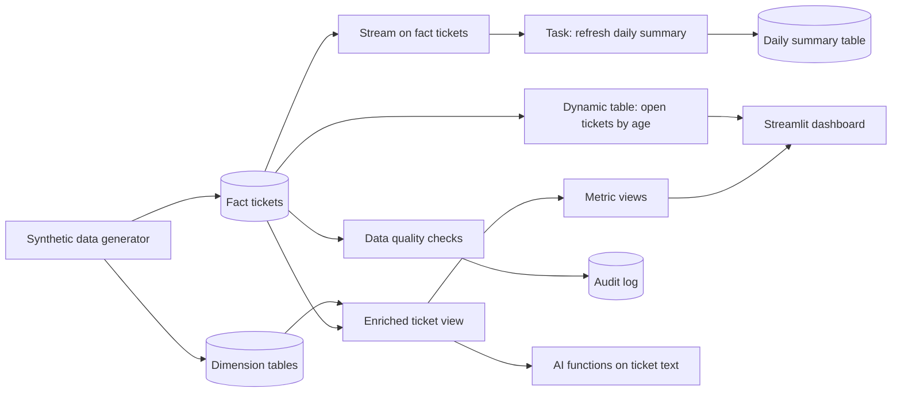
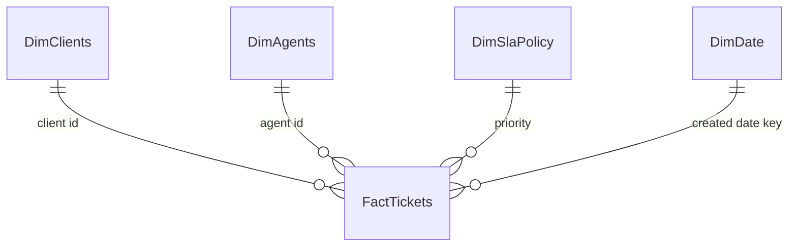

# Client Support Operations Analytics on Snowflake

An end-to-end support analytics project: a star-schema warehouse of synthetic support tickets, SLA and customer health metrics, an automated pipeline, role-based access with PII masking, data quality monitoring, AI text enrichment, and a Streamlit dashboard. It's built to mirror the work of a support analyst who owns client support tooling and reporting.

> \*\*Data note:\*\* All data is synthetic and generated in SQL. No real client data is use. A handful of patterns in the data are planted on purpose (i.e., slow responses for weekends/Basic-tier clients) so that the metrics and dashboard could check and actually recover them. The findings below show the analysis workflow, not discoveries about a real business.

## The problem

A support manager needs to answer a few questions every week:

* Are we meeting our SLAs, and where are we missing them?
* Which clients generate the most work, and which accounts are getting worse?
* How big is the backlog, and how old is it?
* Can we trust the data behind these numbers?

This project answers those questions from raw ticket data, end to end.

## What's in the project

|Area|What I built|Snowflake features|
|-|-|-|
|Data|150,000 synthetic tickets, 500 clients, 40 agents, SLA policy and date dimensions|`GENERATOR`, `UNIFORM`, `RANDOM`|
|Model|Star schema with documented keys|Primary/foreign key constraints (informational)|
|Metrics|First response and resolution SLA, breach rates, CSAT trend, reopen rate, client volume (Pareto), agent leaderboard, at-risk clients|Views, window functions (`LAG`, `RANK`, rolling averages), `PERCENTILE\_CONT`, `QUALIFY`|
|Pipeline|Daily summary table refreshed only when new tickets arrive|Streams, Tasks, `MERGE`|
|Backlog|Open tickets by age bucket, always current|Dynamic Tables|
|Security|Read-only analyst role, masked client contact info|RBAC, masking policies|
|Loading|Unload and reload round trip with reconciliation|Stages, file formats, `COPY INTO`|
|Data quality|14 automated checks logged to an audit table, with the offending rows queryable|Stored procedure, scheduled Task|
|Client health|Weekly 0-100 health score and a plain-English account summary|Views, window functions|
|AI enrichment|Sentiment, auto-categorization with accuracy validation, per-client summaries|`AI\_SENTIMENT`, `AI\_CLASSIFY`, `AI\_SUMMARIZE\_AGG`|
|Reporting|Four-page interactive dashboard|Streamlit in Snowflake|

## Architecture



## Data model
 

 
| Diagram entity | Snowflake table | Key | Main columns |
|---|---|---|---|
| FactTickets | `FACT_TICKETS` | `ticket_id` | `client_id`, `agent_id`, `priority`, `created_date_key`, `created_at`, `first_response_at`, `resolved_at`, `category`, `channel`, `status`, `subject`, `description`, `csat_score`, `is_reopened` |
| DimClients | `DIM_CLIENTS` | `client_id` | `client_name`, `plan_tier`, `industry`, `region`, `signup_date`, `contact_email` (masked), `contact_phone` (masked) |
| DimAgents | `DIM_AGENTS` | `agent_id` | `agent_name`, `team`, `hire_date` |
| DimSlaPolicy | `DIM_SLA_POLICY` | `priority` | `first_response_target_min`, `resolution_target_min` |
| DimDate | `DIM_DATE` | `date_key` | `date_day`, `is_weekend`, `week_start`, `month_start` |

## Metric definitions

Being explicit about definitions matters more than the SQL. These are the choices I made:

* **SLA clocks are wall-clock time.** They keep running while a ticket waits on the customer and outside business hours. A real support team often pauses the clock or uses business hours, and that would be a straightforward change to `v\_ticket\_enriched`.
* **First response time** is `created\_at` to `first\_response\_at`, in minutes. **Resolution time** is `created\_at` to `resolved\_at`.
* **Breach rates only count tickets where the event happened.** A ticket with no response yet is not counted as breached or as met.
* **Impossible timelines are excluded** from metrics (resolved before created) and flagged by the data quality checks rather than silently dropped.
* **CSAT is cohorted by ticket creation month**, not by survey date, and only about 45% of resolved tickets have a score, so response rate is reported next to the average.
* **The health score is a judgment call.** It starts at 100 and subtracts capped penalties for SLA breaches, low CSAT, volume growth, and old open tickets. The weights and the Healthy/Watch/At risk cutoffs are documented in the SQL and should be calibrated against real outcomes.

## Key findings

> Fill this in from your own run. The queries are in section 4 of `sql/03\_stretch\_goals.sql`. Write each finding as a sentence with a number, and keep the caveat that the data is synthetic.

1. **Tier and weekend effect:** *e.g. "Basic-tier P1 tickets breach the first-response SLA 35.2% of the time on weekends versus 25.7% on weekdays."* (query 4a)
2. **SLA breaches and satisfaction:** *e.g. "Tickets that breach an SLA average 3.32 CSAT versus 4.39 for tickets that meet it."* (query 4b)
3. **Where reopens come from:** *e.g. "Reporting/Export has the highest reopen rate at 6.2%."* (query 4c)
4. **Concentration:** *e.g. "The top 10% of clients generate 27.7% of tickets."* (query 4d)
5. **Data quality:** *e.g. "The checks flagged X tickets resolved before creation and Y with no agent."* (`dq\_audit\_log`)
6. **AI enrichment:** *e.g. "AI\_CLASSIFY matched the known category on 87.6% of a 2,000-ticket sample."* Mention that sentiment and CSAT were generated independently, so they don't correlate, and that this is the kind of assumption worth testing on real data.

## Screenshots

The screenshots can be found in here: [/docs/screenshots](https://github.com/JamesCala39/snowflake-support-analytics/tree/03123e964ab1295c7d9fe8aaa088c686397aa484/docs/screenshots)
All screenshots use the default 90-day filter.

* `Overview`: KPI tiles and daily volume with the 7-day average
* `SLA_performance`: breach rate by priority and the weekend versus weekday comparison
* `Backlog`: open tickets by age
* `Clients%Risks`: at-risk clients table
* `dq\_audit.png`: the latest data quality run
  
docs/screenshots

Before you take them, check that no screenshot shows your Snowflake account URL, account identifier, or email.

## Repository layout

```
sql/
  01_synthetic_data.sql         dimensions, fact table, sanity checks
  02_metrics_and_pipeline.sql   keys, metric views, stream + task, dynamic table, RBAC + masking, COPY INTO
  03_stretch_goals.sql          data quality, client health report, AI functions, findings queries
app/
  streamlit_app.py              Streamlit in Snowflake dashboard
docs/
  screenshots/
      * Screenshots of the Streamlit App
```

## How to run it

1. Create a Snowflake free trial account.
2. Run `sql/01_synthetic_data.sql`, then `02`, then `03`, each in its own worksheet, top to bottom.
3. Create a Streamlit app in `SUPPORT_ANALYTICS.CORE` and paste in `app/streamlit_app.py`.

Notes:

* **Masking policies** in script 02 needs Enterprise edition.
* **AI functions** in script 03 are disabled on trial accounts until a credit card is added. Uses trial credits to run, won't be charged.
* **Cost control:** the warehouse is XS with a 60-second auto-suspend. Suspend the dynamic table + tasks and close the Streamlit app when not in use.
* The dataset is frozen at an "as of" date in a `dataset_config` table so results are reproducible. In production you'd use `CURRENT_TIMESTAMP()`.

## Limitations and what I'd do next

* The data is synthetic, and the ticket text comes from templates, so the AI results show the method rather than real-world accuracy.
* SLA clocks don't pause for customer waits or respect business hours.
* The health score weights aren't validated against churn or renewal outcomes.
* With real data I'd add incremental loading from a source system, tests with a tool like dbt, and alerting when data quality checks fail.

